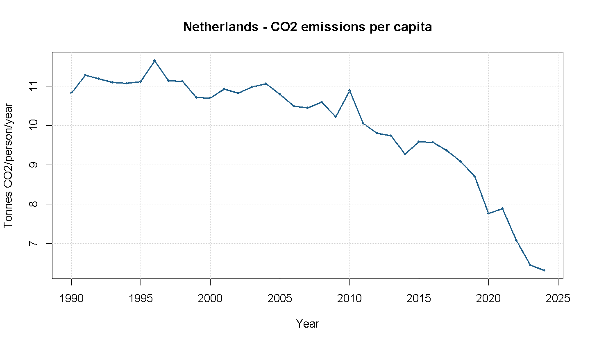

**Student:** Sheldon Buttunga  
**Country / ISO-3:** Netherlands / NLD  
**Study period:** 1990–2024  
**Declared to instructor on:** November 14, 2026

# co2-emissions-NLD
Country-level CO2 emissions analysis for the Netherlands (1990–2024) using R and Our World in Data.
# CO₂ Emissions Analysis: Netherlands (1990–2024)

## Research Question
How have annual CO₂ emissions and CO₂ emissions per capita in the Netherlands changed from 1990 to 2024?

## Data and Methodology
This project uses the Our World in Data (OWID) CO₂ dataset. The dataset was downloaded on November 14, 2026, and filtered for the Netherlands (NLD) from 1990 to 2024 using R. The analysis examined annual CO₂ emissions, annual percentage changes, and emissions per capita.

## Results and Interpretation

The Netherlands' annual CO₂ emissions decreased from 162.64 million tonnes in 1990 to 115.12 million tonnes in 2024, representing an overall reduction of 29.21%. The highest emissions occurred in 2010, reaching 182.58 million tonnes. This shows that emissions initially increased before following a generally declining trend.

Per-capita emissions measure the amount of CO₂ emitted per person, while absolute emissions represent the country's total annual emissions. Per-capita emissions declined from 10.82 tonnes per person in 1990 to 6.32 tonnes in 2024, indicating reductions in both total emissions and emissions relative to population.

A notable change occurred in 2020, when emissions decreased by 10.33% compared with 2019. The largest annual increase occurred in 2010, at 7.07%. According to the Netherlands' National Institute for Public Health and the Environment (RIVM, 2026), the decline in emissions from 2016 onward was associated with reduced coal combustion and increased renewable energy use. The 2020 decline was also influenced by reduced vehicle fuel consumption during the COVID-19 pandemic. These findings provide possible explanations rather than proof of causation.

Reducing CO₂ emissions is important because carbon dioxide contributes to global warming and climate change, which can affect ecosystems, habitats, and biodiversity. However, this analysis has limitations because it examines territorial fossil fuel and industrial CO₂ emissions only. It excludes land-use change and emissions associated with imported products and does not represent every source of greenhouse gases.

## Figures
### Annual CO₂ Emissions

### CO₂ Emissions Per Capita

### Annual Percentage Changes

## Reproducibility
The analysis was performed using R and RStudio. To reproduce the results, download the OWID dataset and save it as `data/owid-co2-data.csv`. Then run the following command from the project root:

`source("scripts/analyze_co2.R")`

## Limitations
The analysis uses territorial emissions, which account for emissions produced within the Netherlands. It does not represent all emissions associated with imported goods and consumption. Missing values were not treated as zero. The results describe observed trends and do not independently establish the causes of changes.

## References
Our World in Data. (n.d.). *CO₂ and greenhouse gas emissions dataset*. https://ourworldindata.org/co2-and-greenhouse-gas-emissions
RIVM. (2026). Greenhouse gas emissions in the Netherlands 1990–2024: National Inventory Document 2026.
https://www.rivm.nl/publicaties/greenhouse-gas-emissions-in-netherlands-1990-2024-national-inventory-document-2026