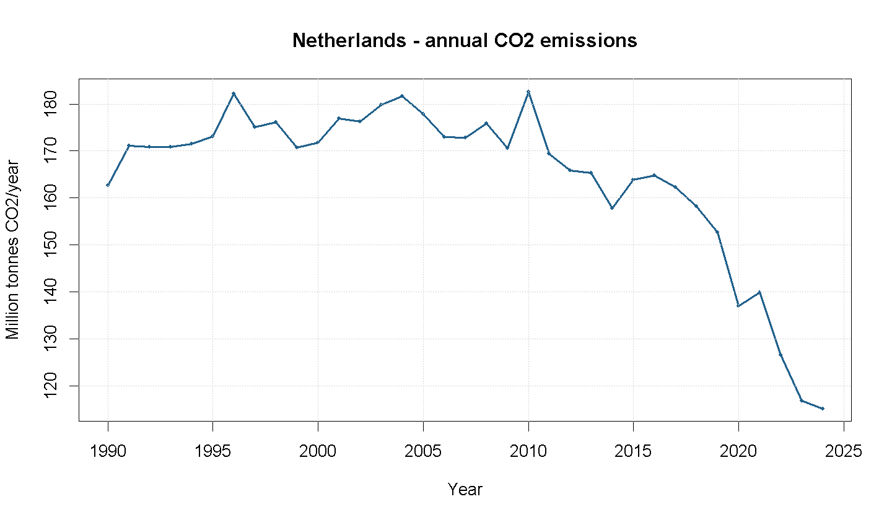
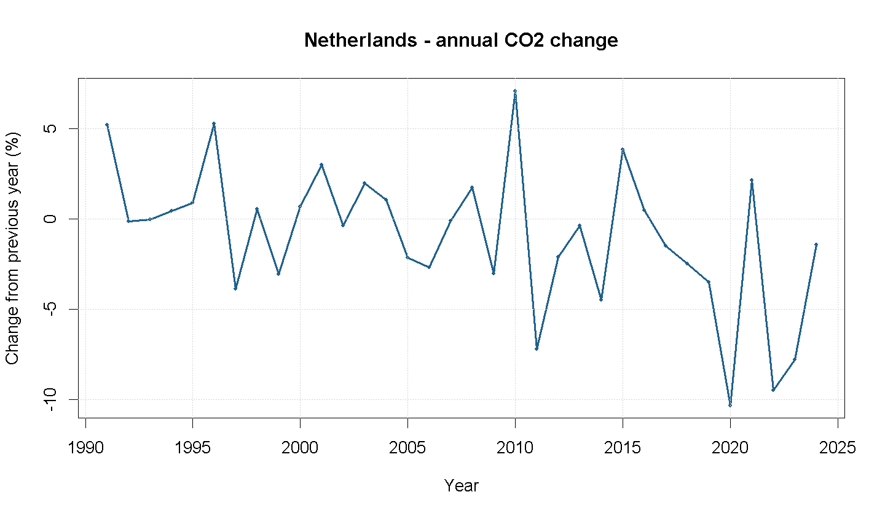

# co2-emissions-NLD
Country-level CO2 emissions analysis for the Netherlands (1990–2024) using R and Our World in Data.
# CO₂ Emissions Analysis: Netherlands (1990–2024)

## Research Question
How have annual CO₂ emissions and CO₂ emissions per capita in the Netherlands changed from 1990 to 2024?

## Data and Methodology
This project uses the Our World in Data (OWID) CO₂ dataset. The dataset was downloaded on November 14, 2026, and filtered for the Netherlands (NLD) from 1990 to 2024 using R. The analysis examined annual CO₂ emissions, annual percentage changes, and emissions per capita.

## Results and Interpretation
The Netherlands' annual CO₂ emissions decreased from 162.64 million tonnes in 1990 to 115.12 million tonnes in 2024, representing an overall decline of 29.21%. Emissions reached their highest value in the selected period in 2010, at 182.58 million tonnes.

Per-capita emissions also declined from 10.82 tonnes per person in 1990 to 6.32 tonnes in 2024. This indicates that both total annual emissions and emissions per person were lower at the end of the study period.

The largest annual increase occurred in 2010 (7.07%), while the largest annual decrease occurred in 2020 (-10.33%). The 2020 decline coincided with the COVID-19 pandemic. Changes in energy use, economic activity, and fuel sources may help explain this pattern, although the dataset alone cannot establish its cause.

These reductions are ecologically important because CO₂ contributes to climate change, which affects ecosystems, habitats, and biodiversity.

## Figures
### Annual CO₂ Emissions

### CO₂ Emissions Per Capita

### Annual Percentage Changes

## Reproducibility
The analysis was performed using R and RStudio. To reproduce the results, download the OWID dataset and save it as `data/owid-co2-data.csv`. Then run the following command from the project root:

`source("scripts/analyze_co2.R")`

## Limitations
The analysis uses territorial emissions, which account for emissions produced within the Netherlands. It does not represent all emissions associated with imported goods and consumption. Missing values were not treated as zero. The results describe observed trends and do not independently establish the causes of changes.

## References
Our World in Data. (n.d.). *CO₂ and greenhouse gas emissions dataset*. https://ourworldindata.org/co2-and-greenhouse-gas-emissions